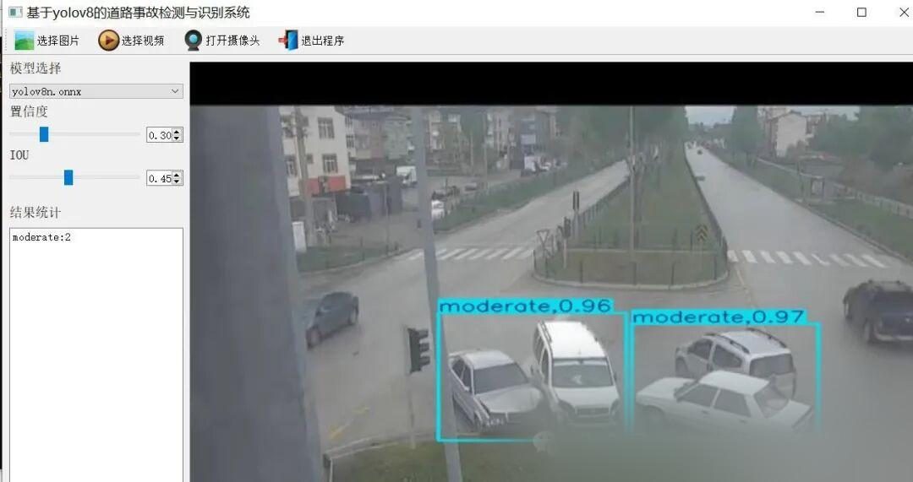
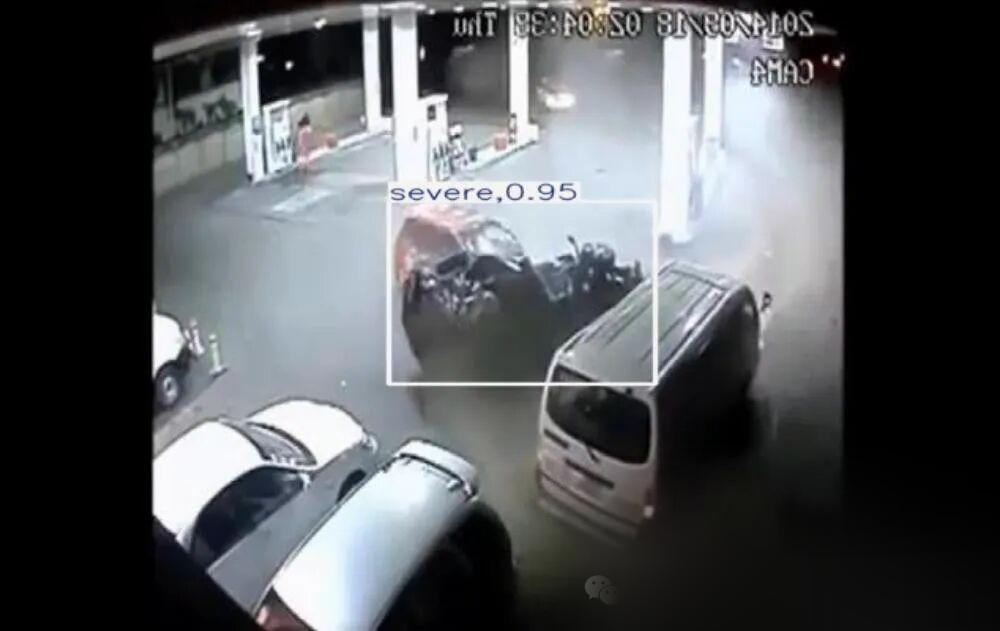
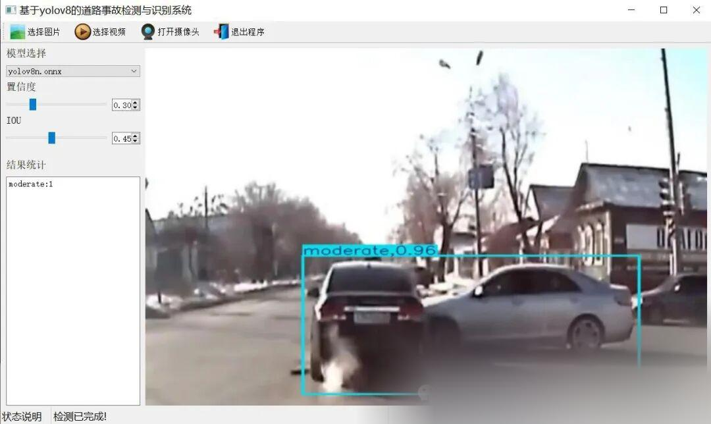

# C# [Winform] Road Traffic Accident Detection System Based on YOLOv8

[Important Notice]

This system employs OpenCVSharp for image processing and ONNX Runtime as the inference engine, utilizing CPU for inference. It is suitable for both Windows X64 systems with or without a graphics card, and does not support macOS and Linux systems. It does not support x86 Windows operating systems. Since it uses CPU inference, it is slower than GPU-based inference. To accommodate most operating systems, we have temporarily only written the CPU inference source code. The GPU inference source code may be adjusted later based on needs. Currently, we are primarily considering CPU inference, mainly to accommodate students who do not have a graphics card and many of whom are using this source code.

[Algorithm Introduction]

A road traffic accident detection system based on YOLOV8 is an advanced intelligent traffic monitoring solution. It utilizes the cutting-edge target detection algorithm YOLOV8 to achieve efficient and real-time detection of traffic accidents.

This system integrates a custom road traffic accident dataset to train and optimize the YOLOV8 model, enabling it to precisely identify the occurrence and type of traffic accidents. In practical applications, the system can quickly recognize various targets in video streams, such as vehicles and pedestrians, and accurately determine whether they are involved in traffic accidents.

Furthermore, the system implements a user-friendly and easy-to-operate interface through the PyQt5 framework. Users can monitor traffic conditions in real time, view accident detection results, and perform related operation settings through this interface. The system supports target detection using images, videos, and cameras, while also supporting real-time display of detection results, facilitating subsequent analysis and processing by users.

The road traffic accident detection system based on YOLOV8 is not only suitable for urban road monitoring but can also be applied to more complex traffic scenarios such as expressways and transportation hubs. It can help reduce the response time of emergency services, minimize traffic congestion, and provide data support for the analysis of accidents and the formulation of preventive measures.

Overall, the road traffic accident detection system based on YOLOV8 provides an intelligent and automated solution for traffic safety, which helps to improve urban traffic management level and ensure the safety of pedestrians and drivers.

[Effect Display]







[Test Environment]

Windows 10 x64 system
Visual Studio 2019
.NET Framework 4.7.2
OpenCVSharp 4.8.0
ONNX Runtime 1.16.3

The model can detect the category.

accident
moderate
severe

[Related datasets (datasets not trained on this article)]

[Training Information]

| Parameter | Value |
| ----------- | -------- |
| Training set images count | 7089 |
| Validation set images count | 1084 |
| Training map | 95.9% |
| Training precision (Precision) | 92.0% |
| Training recall rate (Recall) | 93.5% |

###### Validation set test accuracy information

|

Category

 ||

MAP50 (unit:%)

 |
|

all

 ||

96

 |
|

accident

 ||

91

 |
|

moderate

 ||

98

 |
|

severe

 ||

99

 |

[Partial Implementation Source Code]

-
-
-
-
-
-
-
-
-
-
-
-
-
-
-
-
-
-
-
-
-
-
-
-
-
-
-
-
-
-
-
-
-
-
-
-
-
-
-
-
-
-
-
-
-
-
-
-
-
-
-
-
-
-
-
-
-
-
-
-
-
-
-
-
-
-
-
-
-
-
-
-
-
-
-
-
-
-
-
-
-
-
-
-
-
-
-
-
-
-
-
-
-
-
-
-
-
-
-
-
-
-
-
-
-
-
-
-
-
-
-
-
-
-
-
-
-
-
-
-
-
-
-
-
-
-
-
-
-
-
-
-
-
-
-
-
-
-
-
-
-
-
-
-
-
-
-
-
-
-
-
-
-
-
-
-
-
-
-
-
-
-
-
-
-
-
-
-
-
-
-
-
-
-
-
-
-
-
-
-
-
-
-
-
-
-
-
-
-
-
-
-
-
-
-
-
-
-
-
-
-
-
-
-
-
-
-
-
-
-
-
-
-
-
-
-
-
-
-
-
-
-
-
-
-
-
-
-
-
-
-
-
-
-
-
-
-
-
-
-
-
-
-
-
-
-
-
-
-
-
-
-
-
-
-
-
-
-
-
-
-
-
-

```
using OpenCvSharp;using System;using System.Collections.Generic;using System.ComponentModel;using System.Data;using System.Diagnostics;using System.Drawing;using System.IO;using System.Linq;using System.Text;using System.Threading;using System.Threading.Tasks;using System.Windows.Forms; namespace FIRC{    public partial class Form1 : Form    {         public bool videoStart = false;//Video stop sign        string weightsPath = Application.StartupPath + "\\weights";//Model Catalog        string labelTxt= Application.StartupPath + "\\weights\\class_names.txt";//Category file        Yolov8Manager detetor = new Yolov8Manager();//Inference engine        public Form1()        {            InitializeComponent();            CheckForIllegalCrossThreadCalls = false;//Thread updates control without error.        }        private void LoadWeightsFromDir()        {            var di = new DirectoryInfo(weightsPath);            foreach(var fi in di.GetFiles("*.onnx"))            {                comboBox1.Items.Add(fi.Name);            }            if(comboBox1.Items.Count>0)            {                comboBox1.SelectedIndex = 0;            }            else            {                tssl_show.Text = "Model not found,Please close the program and put the model intoweightsFolder!";                tsb_pic.Enabled = false;                tsb_video.Enabled = false;                tsb_camera.Enabled = false;            }        }        private void Form1_Load(object sender, EventArgs e)        {            LoadWeightsFromDir();//Load model from directory        }        public string GetResultString(Result result)        {            Dictionary<string, int> resultDict = new Dictionary<string, int>();            for (int i = 0; i < result.length; i++)            {                if(resultDict.ContainsKey( result.classes[i]) )                {                    resultDict[result.classes[i]]++;                }                else                {                    resultDict[result.classes[i]]=1;                }            }             var resultStr = "";            foreach(var item in resultDict)            {                resultStr += string.Format("{0}:{1}\n",item.Key,item.Value);            }            return resultStr;        }        private void tsb_pic_Click(object sender, EventArgs e)        {            OpenFileDialog ofd = new OpenFileDialog();            ofd.Filter = "*.*|*.bmp;*.jpg;*.jpeg;*.tiff;*.tiff;*.png";            if (ofd.ShowDialog() != DialogResult.OK) return;            tssl_show.Text = "Detecting......";            Task.Run(() => {                var sw = new Stopwatch();                sw.Start();                Mat image = Cv2.ImRead(ofd.FileName);                detetor.Confidence =Convert.ToSingle(numericUpDown1.Value);                detetor.IOU = Convert.ToSingle(numericUpDown2.Value);                var results=detetor.Inference(image);                var resultImage = detetor.DrawImage(image,results);                     sw.Stop();                pb_show.Image = OpenCvSharp.Extensions.BitmapConverter.ToBitmap(resultImage);                tb_res.Text = GetResultString(results);                tssl_show.Text = "Test completed!Total time spent"+sw.Elapsed.TotalSeconds+"Second";            });                     }         public void VideoProcess(string videoPath)        {            Task.Run(() => {                 detetor.Confidence = Convert.ToSingle(numericUpDown1.Value);                detetor.IOU = Convert.ToSingle(numericUpDown2.Value);                VideoCapture capture = new VideoCapture(videoPath);                if (!capture.IsOpened())                {                    tssl_show.Text="Video failed to open!";                    return;                }                Mat frame = new Mat();                var sw = new Stopwatch();                int fps = 0;                while (videoStart)                {                     capture.Read(frame);                    if (frame.Empty())                    {                        Console.WriteLine("data is empty!");                        break;                    }                    sw.Start();                    var results = detetor.Inference(frame);                    var resultImg = detetor.DrawImage(frame,results);                    sw.Stop();                    fps = Convert.ToInt32(1 / sw.Elapsed.TotalSeconds);                    sw.Reset();                    Cv2.PutText(resultImg, "FPS=" + fps, new OpenCvSharp.Point(30, 30), HersheyFonts.HersheyComplex, 1.0, new Scalar(255, 0, 0), 3);                    //Display results                    pb_show.Image = OpenCvSharp.Extensions.BitmapConverter.ToBitmap(resultImg);                    tb_res.Text = GetResultString(results);                    Thread.Sleep(5);                  }                 capture.Release();                 pb_show.Image = null;                tssl_show.Text = "Video has stopped!";                tsb_video.Text = "Select video";             });        }        public void CameraProcess(int cameraIndex=0)        {            Task.Run(() => {                 detetor.Confidence = Convert.ToSingle(numericUpDown1.Value);                detetor.IOU = Convert.ToSingle(numericUpDown2.Value);                VideoCapture capture = new VideoCapture(cameraIndex);                if (!capture.IsOpened())                {                    tssl_show.Text = "Camera failed to open!";                    return;                }                Mat frame = new Mat();                var sw = new Stopwatch();                int fps = 0;                while (videoStart)                {                     capture.Read(frame);                    if (frame.Empty())                    {                        Console.WriteLine("data is empty!");                        break;                    }                    sw.Start();                    var results = detetor.Inference(frame);                    var resultImg = detetor.DrawImage(frame, results);                    sw.Stop();                    fps = Convert.ToInt32(1 / sw.Elapsed.TotalSeconds);                    sw.Reset();                    Cv2.PutText(resultImg, "FPS=" + fps, new OpenCvSharp.Point(30, 30), HersheyFonts.HersheyComplex, 1.0, new Scalar(255, 0, 0), 3);                    //Display results                    pb_show.Image = OpenCvSharp.Extensions.BitmapConverter.ToBitmap(resultImg);                    tb_res.Text = GetResultString(results);                    Thread.Sleep(5);                  }                 capture.Release();                 pb_show.Image = null;                tssl_show.Text = "Camera has stopped!";                tsb_camera.Text = "Turn on the camera";             });        }        private void tsb_video_Click(object sender, EventArgs e)        {            if(tsb_video.Text=="Select video")            {                OpenFileDialog ofd = new OpenFileDialog();                ofd.Filter = "Video files(*.*)|*.mp4;*.avi";                if (ofd.ShowDialog() != DialogResult.OK) return;                videoStart = true;                VideoProcess(ofd.FileName);                tsb_video.Text = "Stop";                tssl_show.Text = "Video is being detected....";             }            else            {                videoStart = false;                           }        }         private void tsb_camera_Click(object sender, EventArgs e)        {            if (tsb_camera.Text == "Turn on the camera")            {                videoStart = true;                CameraProcess(0);                tsb_camera.Text = "Stop";                tssl_show.Text = "Camera is in detection mode....";             }            else            {                videoStart = false;             }        }         private void tsb_exit_Click(object sender, EventArgs e)        {            videoStart = false;            this.Close();        }         private void trackBar1_Scroll(object sender, EventArgs e)        {            numericUpDown1.Value = Convert.ToDecimal(trackBar1.Value / 100.0f);        }         private void trackBar2_Scroll(object sender, EventArgs e)        {            numericUpDown2.Value = Convert.ToDecimal(trackBar2.Value / 100.0f);        }         private void numericUpDown1_ValueChanged(object sender, EventArgs e)        {            trackBar1.Value = (int)(Convert.ToSingle(numericUpDown1.Value) * 100);        }         private void numericUpDown2_ValueChanged(object sender, EventArgs e)        {            trackBar2.Value = (int)(Convert.ToSingle(numericUpDown2.Value) * 100);        }         private void comboBox1_SelectedIndexChanged(object sender, EventArgs e)        {            tssl_show.Text="Load model:"+comboBox1.Text;            detetor.LoadWeights(weightsPath+"\\"+comboBox1.Text,labelTxt);            tssl_show.Text = "Model loading is complete.!";        }    }}
```

[Usage Steps]

Usage Steps:
1. First, install the YOLOv8 environment according to the official framework https://github.com/ultralytics/ultralytics and convert your own PT model into ONNX model using the official export command.
2. Open the Sln project in VS2019, select x64 release, and modify some necessary parameters such as input shape, etc. Click Run to view the final result.

Please note that if there are any runtime errors, refer to my blog for re-invoking the DLL of my source code: https://blog.csdn.net/FL1623863129/article/details/135424751

[Provided Files]

C# Source Code
YOLOv8n.onnx Model (No PyTorch model provided)
Training Map, P, R Curve Plots (in weights\results.png)
Test Images (under test_img folder)

[Video demonstration]

[C#][WinForm] Road Traffic Accident Detection System Based on YOLOv8 - C# Source Code + ONNX Model + Evaluation Indicator Curves + Beautiful GUI Interface - Bilibili [Test Environment] Windows 10 x64 System VS2019 .NET Framework 4.7.2 OpenCVSharp 4.8.0 ONNX Runtime 1.16.3 For more information and source code download, refer to the blog: https://blog.csdn.net/FL1623863129/article/details/143069821, Video views: 1, comments: 0, likes: 0The number of coin flips is 0, the number of collectors is 0, and the number of forwarders is 0. The video author is Future Autonomous Research Center, and the author's biography is Future Autonomous Research Center. Relevant videos: C# WinForm deployment of a YoloX-ONNX model using pure OpenCVSharp, C# WinForm deployment of a Yolov11-Pose Pose Estimation ONNX model, C# WinForm deployment of a Yolov8 ONNX instance segmentation model, C++ version of Yolov8 ONNX model encryption method to protect your model and copyright, Python source code for a flame smoke detection system based on Yolov8, ONNX model, evaluation metrics curve, and a beautiful GUI interface.Deploy the official YOLOv8-OBB rotation box detection ONNX model in C#. Deploy the ONNX model of YOLOv8 using Easy Language. A PCB Defect Detection System based on YOLOv8 with Python source code, ONNX model, evaluation metrics curve, and a beautiful GUI interface. Deploy YOLOv8 and bytetrack for target tracking using C++. Implement real-time chat functionality using Wenxin Yiyan's large model based on C# Winform. https://www.bilibili.com/video/BV1ykCXYTEKo/

[Source code download link]

Follow the WeChat public account of Future Autonomous Research Center and reply with "firc4" to get the download method.


## Payment

Here is a pay link on Stripe ( https://buy.stripe.com/3cs8yP7sY87d0vu9AB ). Please contact me lonlonago@foxmail.com after funding $89, and I will send you a complete data files , thank you!


